# eonyx

**Live app:** https://eonyx.vercel.app

eonyx is a fashion shopping app. It runs on iPhone and Android through Expo Go, and on any browser as an installable web app (PWA). You can browse looks and products, save what you like, and check out in four steps with one total and no hidden fees.

The app is a prototype. The catalogue, orders and checkout are stored on the device, and no payment is taken.

## Screens

### Browse

<table>
  <tr>
    <td align="center" width="25%">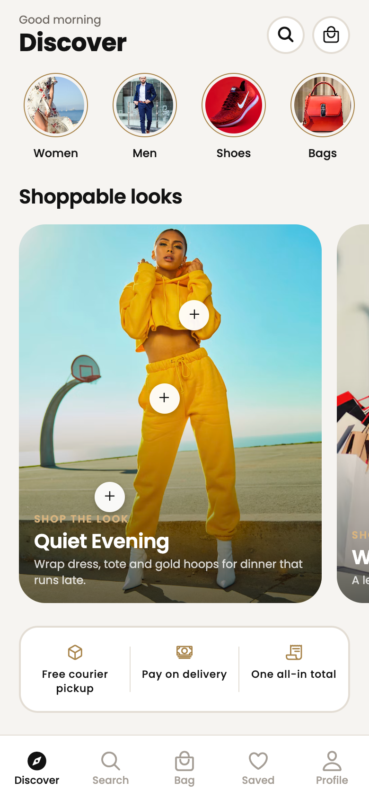<br><sub>Discover</sub></td>
    <td align="center" width="25%">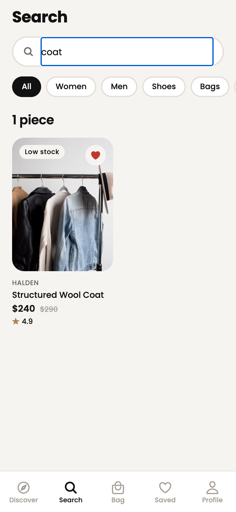<br><sub>Search</sub></td>
    <td align="center" width="25%">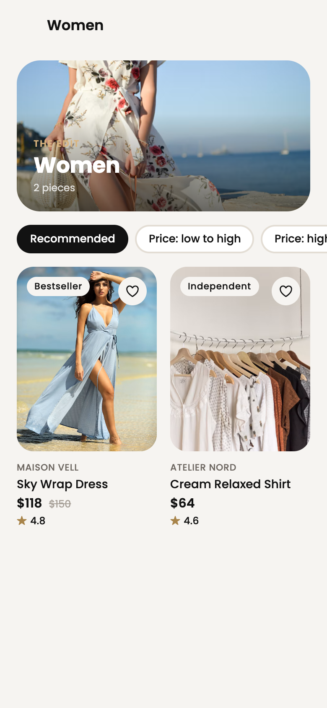<br><sub>Category</sub></td>
    <td align="center" width="25%">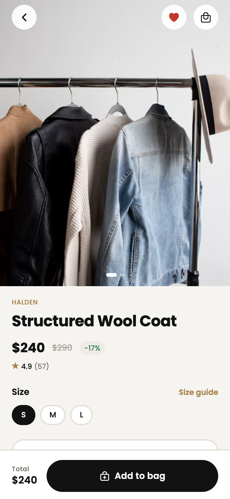<br><sub>Product</sub></td>
  </tr>
</table>

### Bag and checkout

<table>
  <tr>
    <td align="center" width="25%">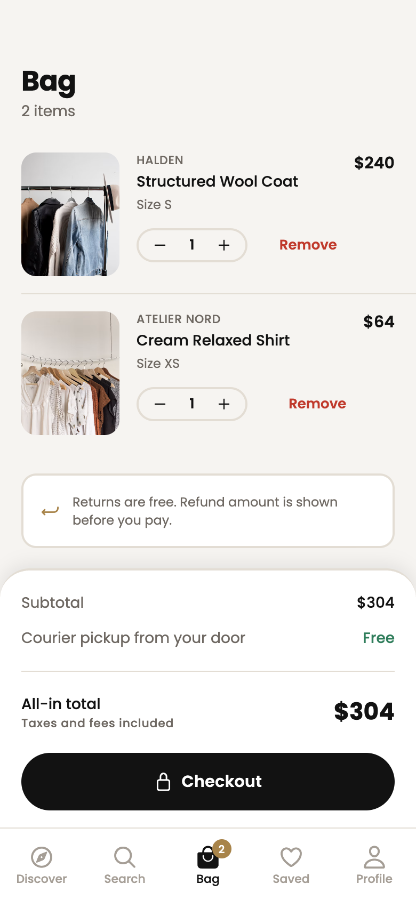<br><sub>Bag</sub></td>
    <td align="center" width="25%">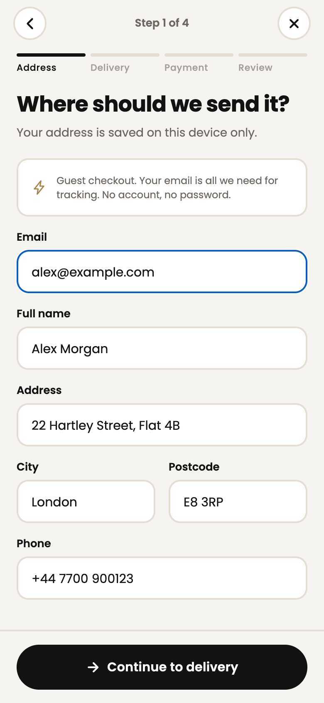<br><sub>Address</sub></td>
    <td align="center" width="25%">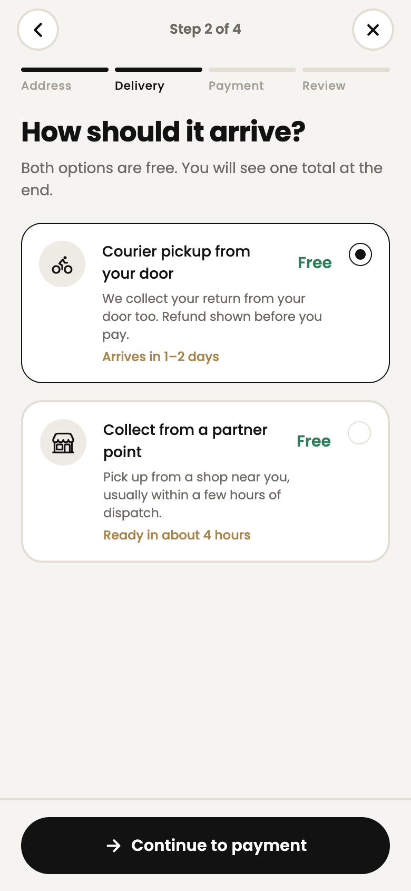<br><sub>Delivery</sub></td>
    <td align="center" width="25%">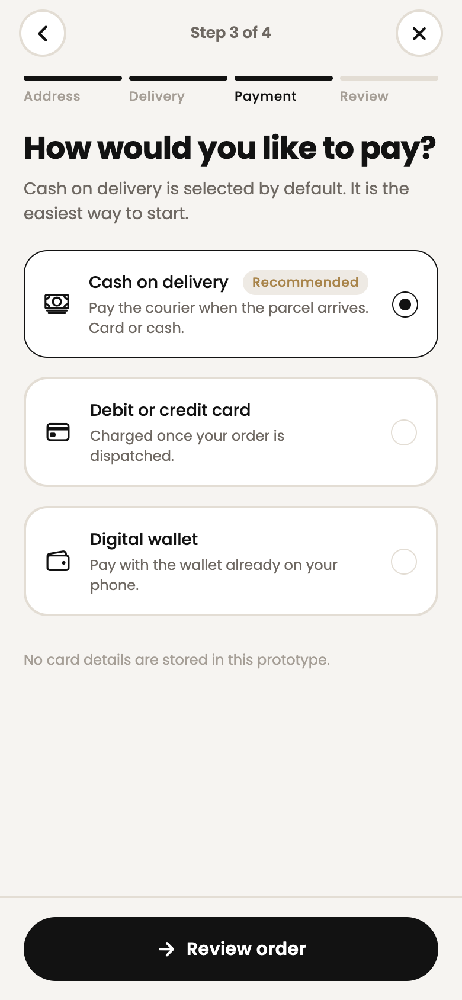<br><sub>Payment</sub></td>
  </tr>
</table>

### Review and orders

<table>
  <tr>
    <td align="center" width="25%">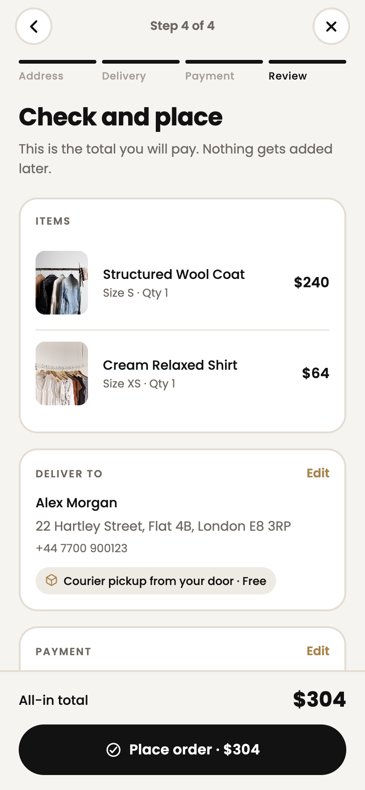<br><sub>Review</sub></td>
    <td align="center" width="25%">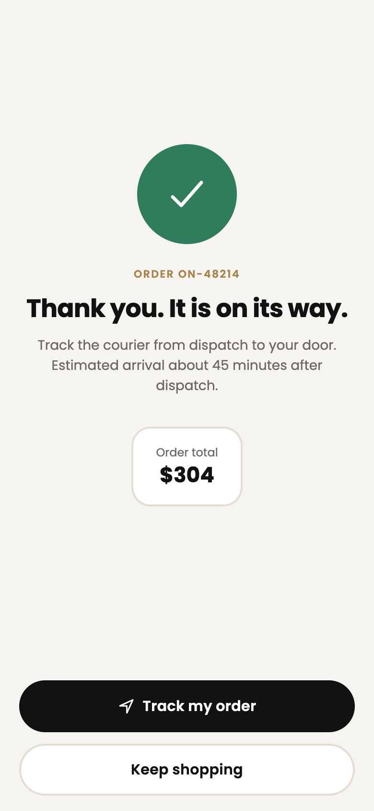<br><sub>Order placed</sub></td>
    <td align="center" width="25%">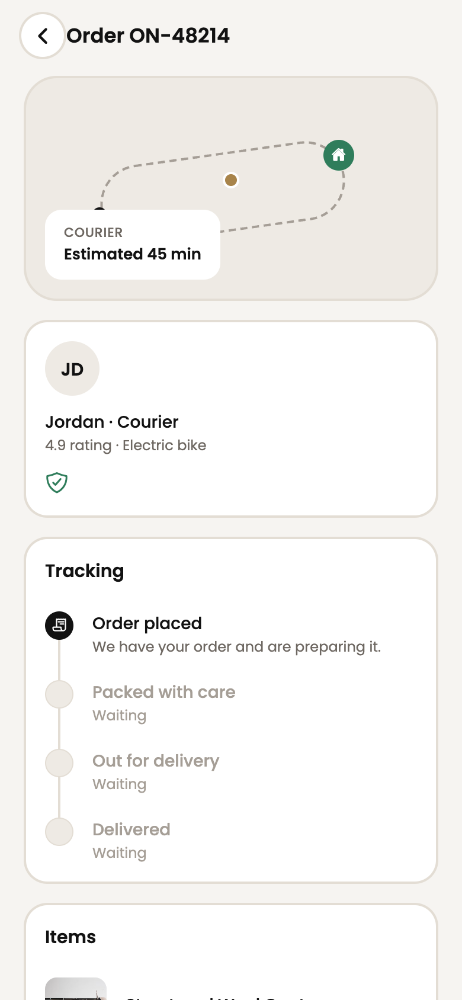<br><sub>Order tracking</sub></td>
    <td align="center" width="25%"><br><sub>Added to bag</sub></td>
  </tr>
</table>

### Account, sign in and dark mode

<table>
  <tr>
    <td align="center" width="25%">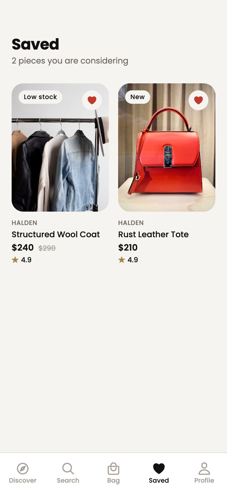<br><sub>Saved</sub></td>
    <td align="center" width="25%">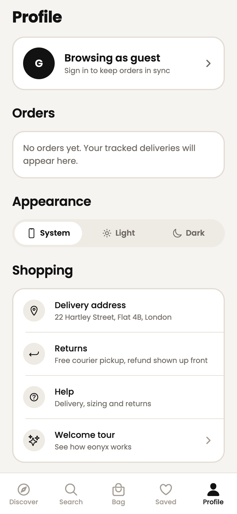<br><sub>Profile</sub></td>
    <td align="center" width="25%">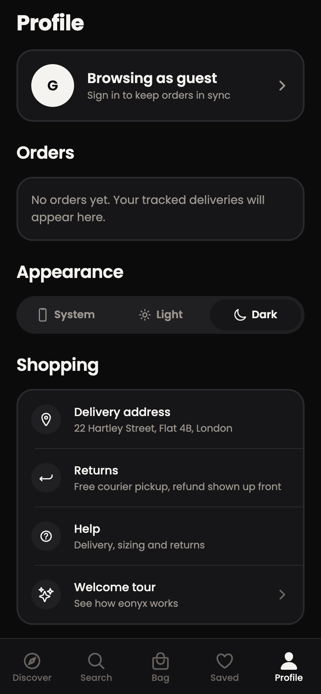<br><sub>Profile, dark mode</sub></td>
    <td align="center" width="25%">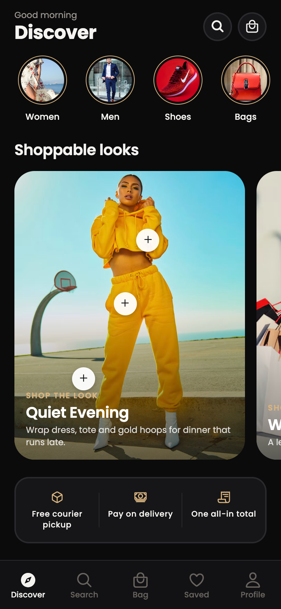<br><sub>Discover, dark mode</sub></td>
  </tr>
</table>

### Welcome and sign in

<table>
  <tr>
    <td align="center" width="25%"><br><sub>Welcome</sub></td>
    <td align="center" width="25%">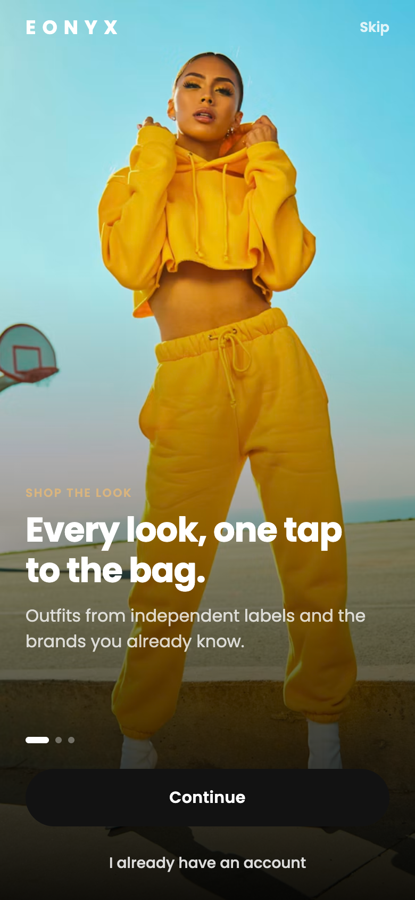<br><sub>Welcome, second slide</sub></td>
    <td align="center" width="25%">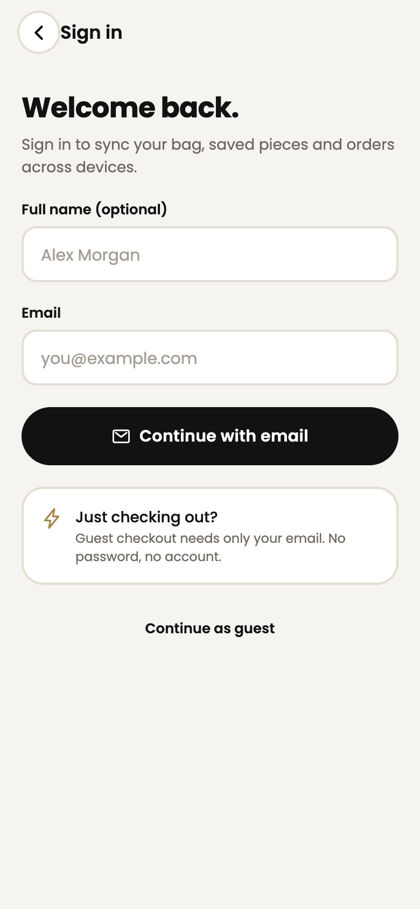<br><sub>Sign in</sub></td>
      </tr>
</table>

The full flow, from the welcome screen to order tracking, is in [docs/ui-flow.svg](docs/ui-flow.svg).

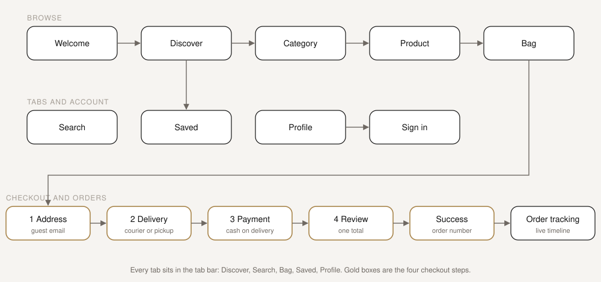

## Run it locally

You need Node.js 22.13 or newer.

```bash
git clone https://github.com/saivanka/eonyx.git
cd eonyx
npm install
npx expo start
```

Then do one of these:

- Press `w` to open the web version.
- Scan the QR code with Expo Go on your phone (same Wi-Fi network).

## Build the web app

```bash
npm run build:web   # writes dist/ and adds the PWA tags and service worker
npm run serve:web   # serves dist/ at http://localhost:5057
```

To install the web app on a phone, open the HTTPS link in Safari or Chrome and add it to your home screen. Installing only works over HTTPS, so use the live link, not a local Wi-Fi address.

More detail:

- [docs/PWA.md](docs/PWA.md) explains how the web app is installed and cached.
- [docs/DEPLOYMENT.md](docs/DEPLOYMENT.md) explains how to publish a new version.

## How it's built

- **Expo SDK 58** with **Expo Router** for screens and navigation.
- **React Native** for the interface, and **react-native-web** for the browser build.
- **Poppins** for type, with a small set of text styles in `src/theme/tokens.ts`.
- Light and dark themes, plus a System option.
- A small reducer-based store (`src/store/StoreContext.tsx`) for the bag, saved items, orders and checkout choices.
- A service worker (`public/sw.js`) so the web app loads offline after the first visit.

## Project layout

```
src/
  app/          Screens. Each file is a route.
  components/   Shared pieces: buttons, headers, product cards, checkout steps.
  data/         Sample products, looks and categories.
  lib/          Price and date formatting, haptics, web layout width.
  store/        Bag, saved items, orders and checkout state.
  theme/        Colours, type, spacing and the theme switch.
public/         Files copied as they are into the web build (manifest, icons, service worker).
scripts/        The post-build step that adds PWA tags.
docs/           Guides, the flow diagram and the screenshots.
```

## Scripts

| Command | What it does |
| --- | --- |
| `npx expo start` | Start the development server |
| `npm run build:web` | Build the web app into `dist/` |
| `npm run serve:web` | Serve the build locally |
| `npx tsc --noEmit` | Check types |
| `npx expo-doctor` | Check the Expo setup |

## Notes

- **Photos** come from Unsplash, under the Unsplash licence. The product names, brands and prices are invented.
- **Design reference.** The flow follows the *Onyx – Fashion Marketplace App* case study by Saqib Ali on Behance. This project doesn't use that case study's images or copy. The screenshots above are of this app.
- **npm install** uses `legacy-peer-deps` (set in `.npmrc`). Expo Router's peer dependencies don't resolve cleanly otherwise.

## Licence

The project started from Expo's MIT-licensed starter template. See [LICENSE](LICENSE).
